# NF1.UD3. Usuaris i grups

## Objectiu de la tasca

L’objectiu d’aquesta tasca és practicar l’administració d’usuaris i grups a Ubuntu Server.
 S’han creat els grups necessaris i diversos usuaris amb els seus directoris personals i shells corresponents. També s’ha configurat el fitxer de benvinguda, l’estructura de `/etc/skel` i l’àlies `ll`; s’han comprovat els fitxers del sistema relacionats amb els comptes, s’ha gestionat el bloqueig i desbloqueig d’un usuari, s’ha eliminat un compte i s’ha configurat el shell Fish per a `laura_dev`.

## 1. Creació de la jerarquia de grups

Les ordres següents creen els grups devs, sysadmin i auditor.

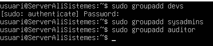

```bash
sudo addgroup devs
sudo addgroup sysadmin
sudo addgroup auditor
```

A continuació comprovem els grups a la carpeta `/etc/group`

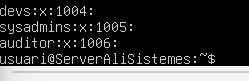

## 2. Gestió dels perfils d'usuari

> Passem al ssh per més comoditat

Creem l'arxiu benvinguda.txt i posem les normatives.

```bash
nano ~/benvinguda.txt
```

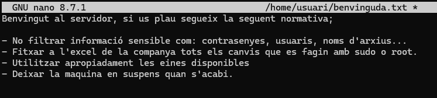

Creem el directori `Documents` que utilitzarán els usuaris nous.

```bash
mkdir -p ~/Documents
```

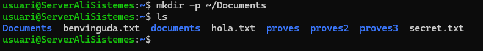

Entrem al directori plantilla `/etc/skel` i editem el fitxer `.bashrc` per configurar l’àlies ll.
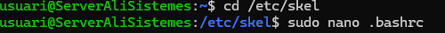

```bash
cd /etc/skel

sudo nano .bashrc
```

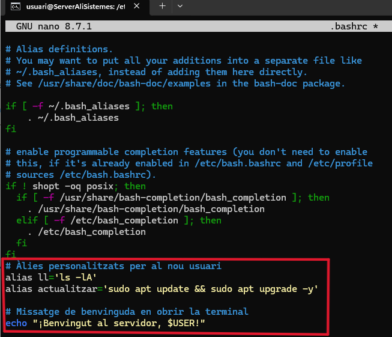

Comprovem la comanda alias ll

```bash
alias ll
```

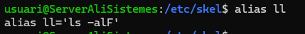

Editem la config d’adduser per comprovar que el shell per defecte és Bash.

```bash
sudo nano /etc/adduser.conf
```


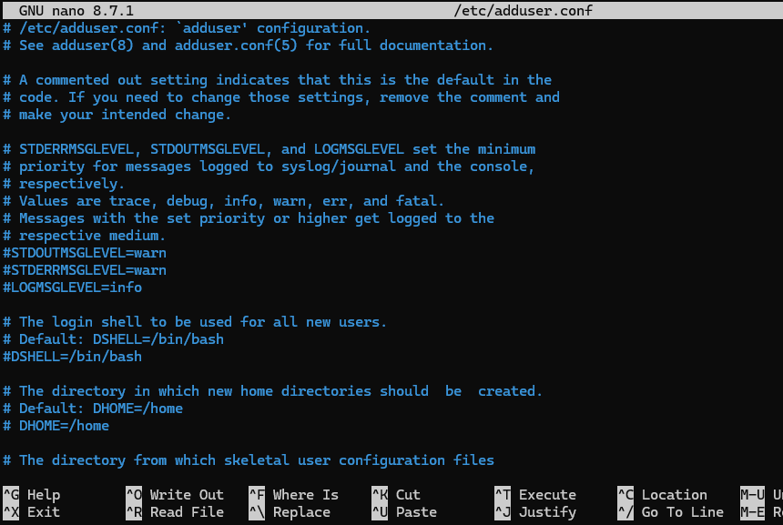

Creem l'usuari de prova `test1` amb la contrasenya `test1`

```bash
sudo adduser test1
```

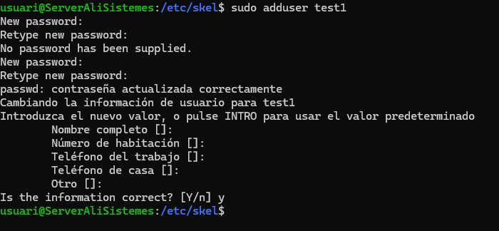

## 3. Creació i configuració d'usuaris

Ara creem els usuaris `pau_dev` i `laura_dev` amb les contrasenyes `usuari`

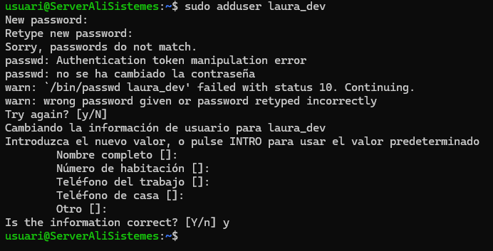
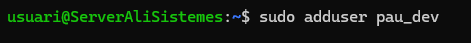
